# Company Knowledge Assistant: an AI assistant for a security and access-control integrator

> A private, company-wide AI assistant built for a **security and access-control integrator** (name withheld; screenshots use the fictional brand *Northwind*). It answers staff questions from partner documentation, websites, company files and email, files every new document by itself, drafts and sends email from people's own mailboxes, and routes every message to the best of several AI models for that task.
>
> **This is a public walkthrough.** The source code is in a private repository; this page explains what the system does, how it is built and the decisions behind it. Screenshots use demo data under a fictional brand; the chat answers are real answers from the system with names swapped.

**Role:** sole designer and developer (product, backend, retrieval, front end, deployment).
**Status:** deployed internally and in use by the client's team (October 2026).
**Stack:** Python · FastAPI · SQLite FTS5 · sentence-transformers (MiniLM + cross-encoder) · OpenRouter · Zoho Mail API · Google Drive API · PDF.js · LibreOffice · Tesseract · Docker on Railway

---

## The problem

The company installs and supports systems from eight specialist partners: hotel locks, biometric access control, smart-room energy management, hotel networks, cyber security, doors and security hardware (two suppliers), and building fit-out products. The answers to everyday questions were spread across thousands of manual pages, partner websites, PDFs in Google Drive and years of email:

- *"How do I enrol a fingerprint in the access-control software?"*
- *"Which network gateway suits a 300-room hotel?"*
- *"When did we last email the client about the site survey?"*

The goal was **one place to ask**, with answers that show where they came from, in English and Catalan (the team works in both), and without the team having to file anything by hand.

---

## What it does

### 1. Ask anything, get a sourced answer
Staff ask in plain language. The assistant searches every source, answers with numbered citations, and opens the cited page in the built-in viewer.

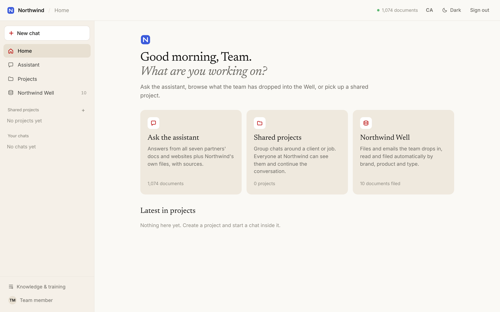

| Answer | Its sources |
|---|---|
| 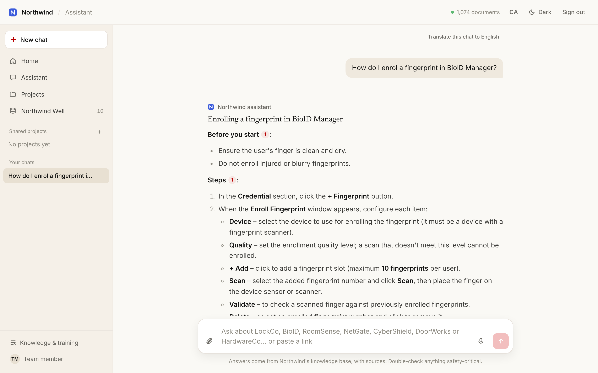 | 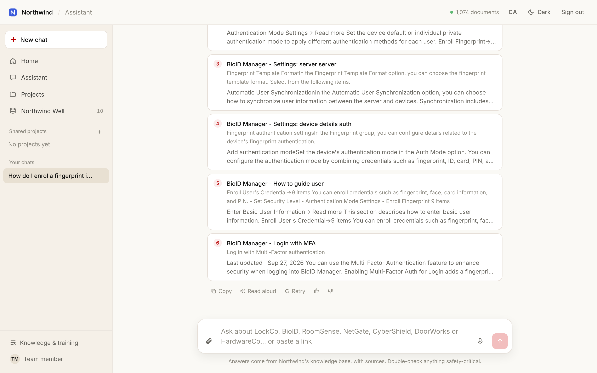 |

### 2. The Well: documents that file themselves
Files dropped in a Google Drive folder, sent to a "Well" mail folder, or dragged onto the page are read, classified by partner, product and document type, titled, and made searchable within seconds. Invoices are detected and grouped by month.

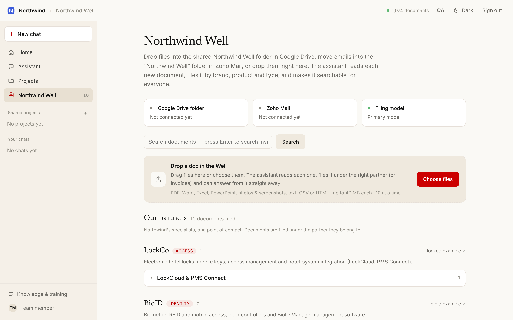

Each partner gets its own section, so a supplier's product list photographed on a phone ends up under that supplier, named page by page:

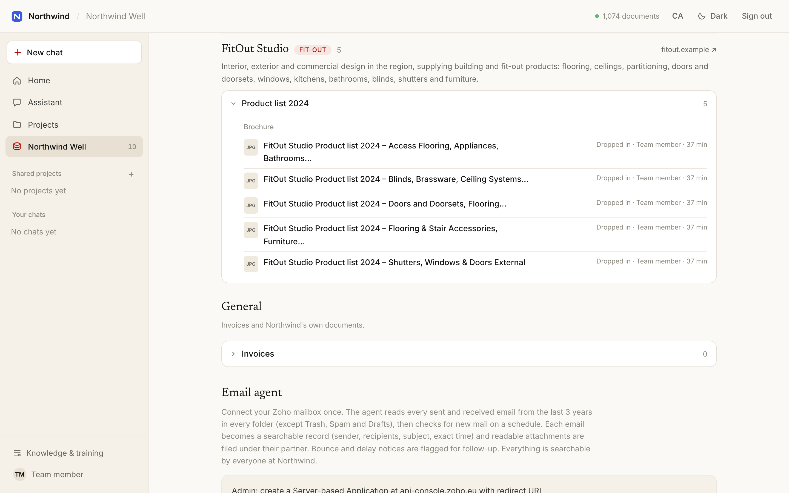

### 3. Smart document search
Hybrid keyword + semantic search across every document, with the matching passages highlighted. Questions in other languages are translated before searching.

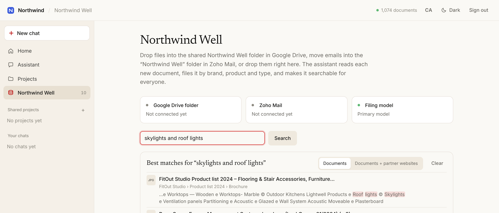

### 4. Reads photos, screenshots and scans
Images and scanned PDFs are transcribed by a vision model (headings, lists and tables preserved), with an offline OCR fallback. The original is kept and shown in the viewer, with the extracted text one click away.

| Document view | Extracted text |
|---|---|
| 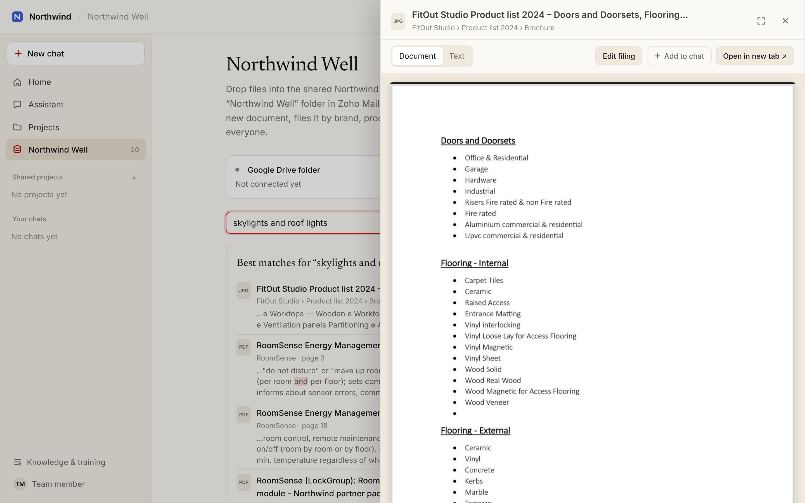 | 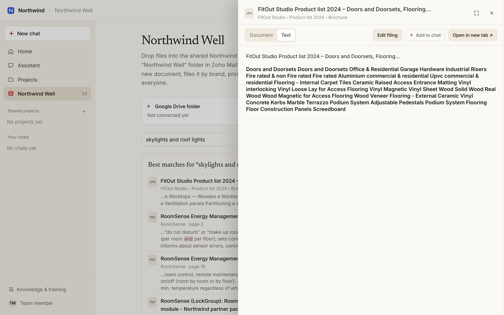 |

If the automatic filing gets something wrong, anyone can correct it in place:

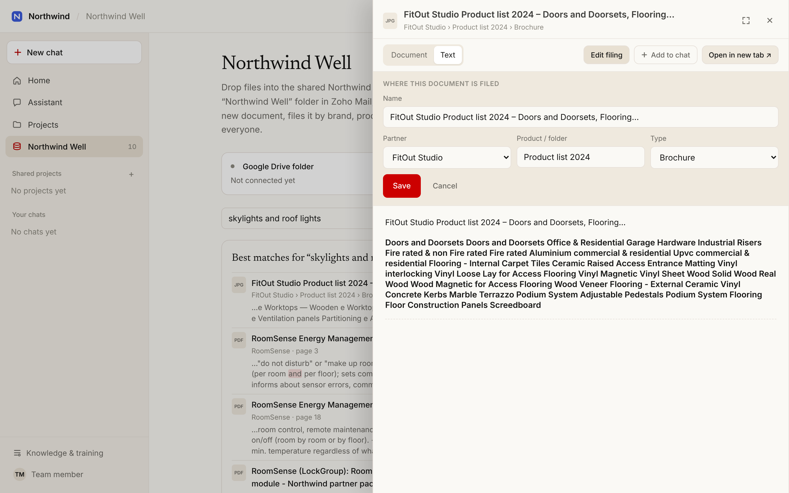

### 5. Attach files and photos straight into a chat
Paperclip, paste or drag and drop. The file is read, filed in the Well and attached to the question, so the assistant reads it in full.

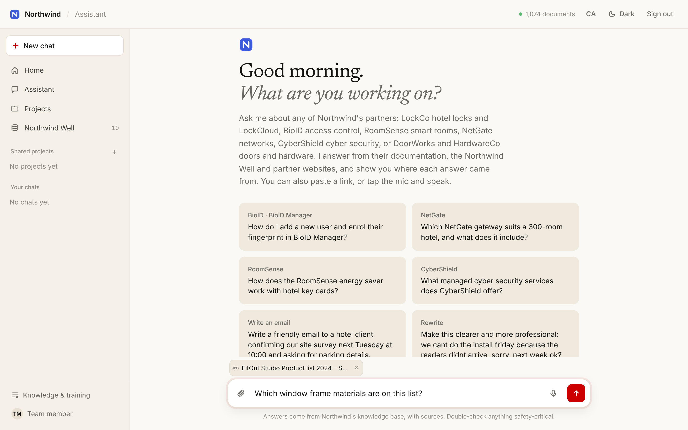

### 6. Email agent
Each person connects their own Zoho mailbox once. The agent indexes sent and received mail (with attachments) so the assistant can answer "when did we last…" questions with exact timestamps. When the assistant writes an email, a panel offers to save it to Zoho Drafts, send it, or schedule it. It suggests recipients from past correspondence and attaches documents from the Well.

| Drafted in chat | Email panel |
|---|---|
| 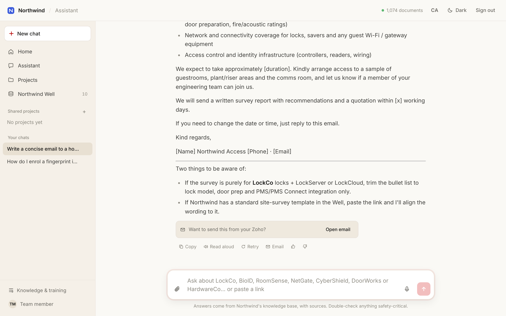 | 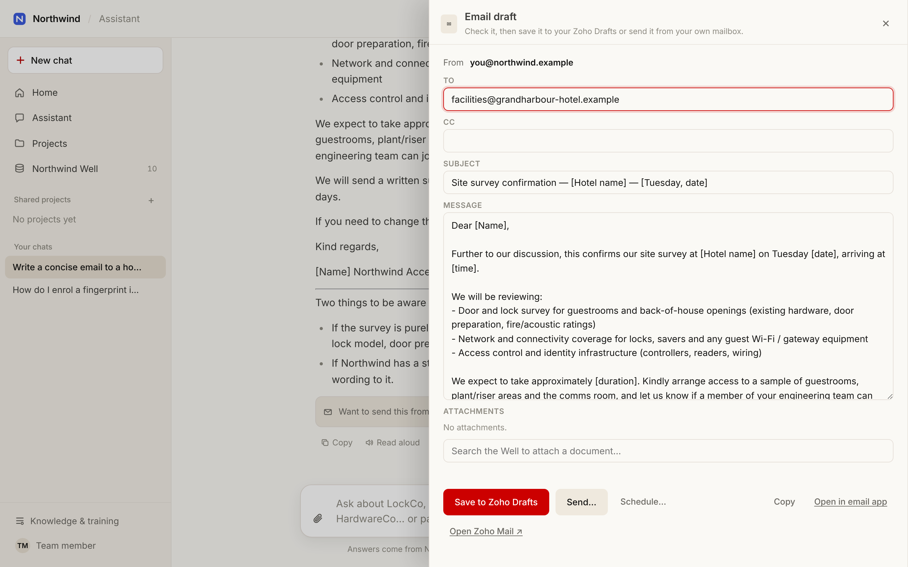 |

### 7. Multi-model routing: the right model for each task
Staff never pick a model. Every message first goes to a **planner**, which works out what kind of job it is. The router then sends it to the model best suited to that job:

| Task (decided per message) | Typical requests | Default model |
|---|---|---|
| **Company knowledge** | product how-tos, partner questions, "when did we last email…" | base model, answering from retrieved sources |
| **Quick tasks** | rewrite, translate, shorten, short replies | Claude Haiku (fast, cheap) |
| **Writing** | emails, letters, proposals | Claude Sonnet |
| **Analysis** | spreadsheets, long attached documents, comparisons | Claude Sonnet (long context) |
| **Reading images** | photos, screenshots, scanned pages | Claude Haiku (vision) |

- **Multi-provider.** One `provider:model` setting per task can point at the base model's own API or at any model on OpenRouter (Claude, GPT, Gemini, Mistral, DeepSeek…). Admins swap models from the panel and can **Test** each one. No redeploy is needed.
- **Context-aware.** The planner also decides whether a message needs the knowledge base at all. General writing skips retrieval. A question with long attached documents is upgraded to the long-context *analysis* route automatically.
- **Never stops.** If a provider isn't configured or a model fails mid-request, the answer falls back to the knowledge model.
- **Cost-tracked and private.** Tokens and cost are logged per task and per model. Every OpenRouter request only goes to providers that don't store or train on prompts (zero-data-retention mode is optional).

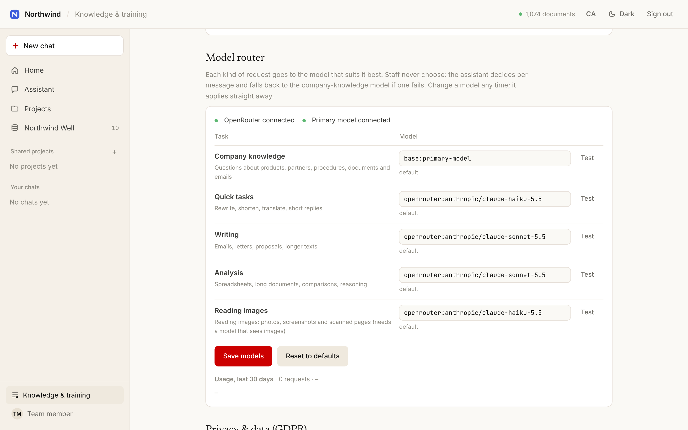

### 8. Teaching it, measuring it, and GDPR
Admins add whole websites or single pages, watch crawls, read 👍/👎 feedback and run a built-in retrieval benchmark. Privacy tools cover data export and deletion per person, retention limits, and a no-training/no-logging policy for every AI provider.

| Knowledge & training | Privacy & data |
|---|---|
| 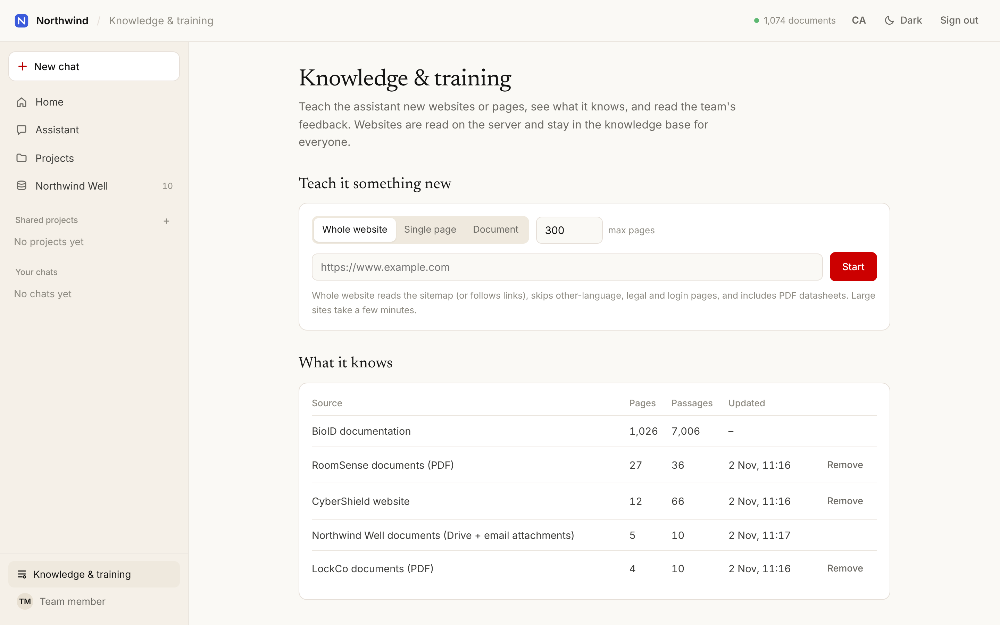 | 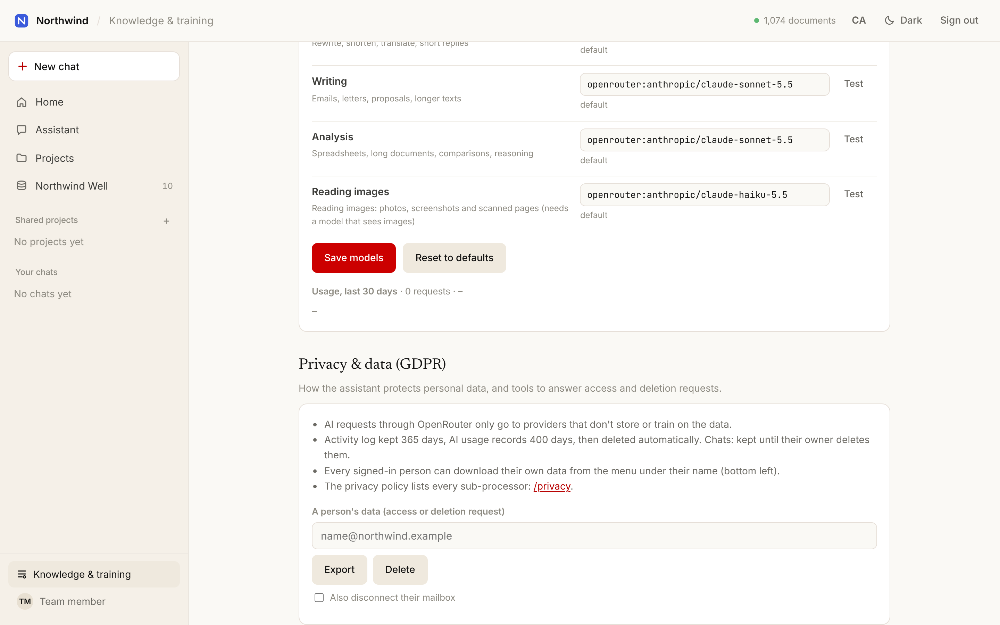 |

---

## How it works

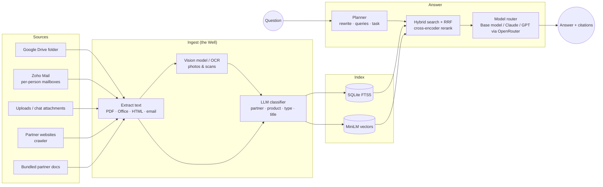

**Answer pipeline**
1. **Understand.** A planner LLM rewrites the message as a standalone question (follow-ups resolved), writes 2–4 search phrasings, names the products involved and picks the task type.
2. **Search.** Each phrasing runs keyword (FTS5) and semantic (MiniLM) search, globally and within the named product. Results are merged with reciprocal-rank fusion.
3. **Re-rank.** A cross-encoder scores the top 40. Menu pages, changelogs and other products' pages are pushed down.
4. **Expand and answer.** The best pages go to the routed model with their surrounding sections. The answer streams back with [n] citations that open the exact page.

**Measured, not guessed.** A 73-question test set (including follow-ups and Catalan questions) runs from the admin panel. A bake-off of free embedding and reranking models chose the current pair. Today the right page is in the top 3 results for **97%** of test questions and in the top 6 for **100%**. The first version managed 61% top-3 on an earlier 44-question set.

---

## Engineering highlights

- **Self-filing ingestion.** Every document is classified by an LLM against the partner catalogue, with a keyword fallback when the model is unavailable. Pages photographed together follow the page that names the supplier. Duplicates are detected by hash.
- **Resilient email backfill.** Three years of mail per mailbox are indexed with per-page cursors and retries, and pages that fail upstream are skipped, so one bad message never stalls a mailbox.
- **One viewer for everything.** PDFs render with PDF.js. Word, PowerPoint and Excel files are converted to PDF on the server with LibreOffice. Images display inline. Originals missing on the server are fetched on demand from Drive or Zoho.
- **Bilingual.** The interface is in English and Catalan (the team works in both), and past chats can be translated after the fact.
- **Privacy by design.**
  - Sign-in is through the company's Zoho accounts.
  - Mailbox tokens are encrypted at rest, and there is an audit log.
  - People can export their own data.
  - Retention windows are enforced.
  - AI requests go only to providers that don't train on or store prompts.
- **Multi-model routing.** A planner classifies each message into one of five task types, and a router sends it to the model configured for that task. The router has provider fallback, a context-length upgrade for long attachments, and cost logging per task.
- **Single-container deployment.** Everything runs in one Docker image on Railway with a persistent volume. Models are baked into the image, and pushes to `main` deploy automatically.

---

*Built by Sebastian Olah. The source code is private; happy to walk through it in an interview.*
